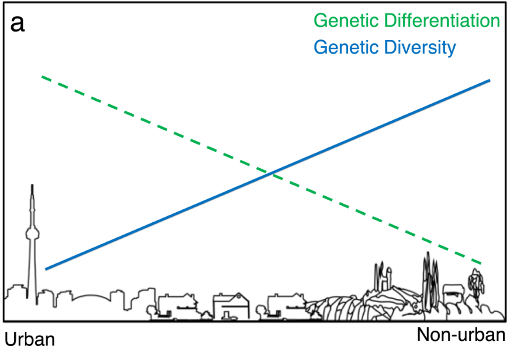
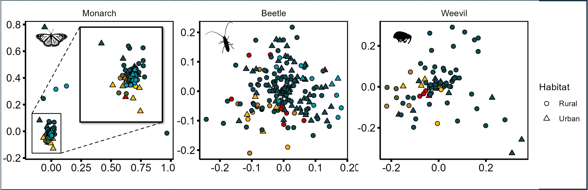

Cities are among the fastest-changing environments on Earth. We use population genetics and genomics to ask how urbanization, human movement, and pest control reshape the evolution of the organisms that share our homes and cities. Our work integrates field sampling, molecular lab work, whole-genome sequencing, and landscape and demographic modeling.

<!-- TODO: Add a photo for each theme: {fig-alt="Description"} -->

::: {.research-theme}
## Urban evolution: gene flow and genetic drift

Do cities act as barriers or highways for gene flow? Do cities increase or decrease genetic drift? We test how urban landscapes, infrastructure, and human-mediated transport shape connectivity, genetic drift, and effective population size in urban populations. Past work has shown that urbanization can *facilitate* gene flow within and between cities.

**Key papers:** 

Miles LS, Rivkin LR, Munshi-South J, Johnson MTJ, & Verrelli BC. 2019. [Gene flow and genetic drift in urban environments](https://doi.org/10.1111/mec.15221). Molecular Ecology, 28, 4138–4151. 

{fig-alt="Describe the photo" width="60%" fig-align="center" .rounded}

Miles LS, Carlen EJ, Nassrullah Z, Munshi-South J, Johnson MTJ. 2025. [No detectable effect of urbanization on genetic drift or gene flow in specialist herbivorous insects of milkweed.](https://doi.org/10.1371/journal.pone.0318956) PloS One.

{fig-alt="Describe the photo" width="60%" fig-align="center" .rounded}

Miles LS, Dyer RJ, & Verrelli BC. 2018. [Urban hubs of connectivity: Contrasting patterns of gene flow within and among cities in the Western black widow spider](https://doi.org/10.1098/rspb.2018.1224). Proceedings of the Royal Society B, 285, 20181224. 

Miles LS, Johnson JC, Dyer RJ, & Verrelli BC. 2018. [Urbanization as a facilitator of gene flow in a human health pest](https://doi.org/10.1111/mec.14783). Molecular Ecology, 27(16), 3219-3230. 

Tassone E, Miles LS, Rosenberg MS, Dyer RJ, Verrelli BC. 2021. [Evolutionary stability, landscape heterogeneity, and human land-usage shape population genetic connectivity in the Cape Floristic Region biodiversity hotspot](https://doi.org/10.1111/eva.13185). Evolutionary Applications, 14(4), 1109-1123.
:::

::: {.research-theme}
## Our oldest pests: humans and the insects that followed us

Some insects have lived with humans for tens of thousands of years. Using whole-genome data and demographic modeling, we reconstruct how pests like bed bugs and German cockroaches tracked human history, from cave dwelling to the first cities to modern global travel.

**Key papers:** 

Miles LS, Verrelli BC, Adams R, Francioli YZ, Card DC, Balvin O, Castoe TA, Booth W. 2025. [Were bed bugs the first urban pest insect? Genome-wide patterns of bed bug demography mirror global human expansion](https://doi.org/10.1098/rsbl.2025.0061). Biology Letters 21, 20250061. 

Miles LS, Adams R, Franciolo YZ, Card DC, Castoe TA, Booth W. 2024. A chromosome-level reference genome for the common bed bug, Cimex lectularius, with identification of sex chromosomes. Journal of Heredity.

:::

::: {.research-theme}
## Pesticide resistance and genomic adaptation

Urban pests evolve rapidly under insecticide pressure. We map resistance mutations, scan genomes for signatures of selection, and ask how socioeconomic differences between neighborhoods shape exposure and adaptation.

**Key papers:** 

Booth W, Miles LS, Balvin O, Lewis CD, Vilimova J, Schal C, Vargo, EL. 2026. [Admixture without recurrent intercontinental gene flow: contrasting patterns of genetic diversity and knockdown resistance profiles reveal independent evolution in resurgent common bed bug populations](https://doi.org/10.1007/s10340-026-02089-z). Journal of Pest Science 99(121). 

Block CJ, Miles LS, Lewis CD, Schal C, Vargo EL, Booth W. 2025. [First evidence of the A302S Rdl insecticide resistance mutation in populations of the bed bug, Cimex lectularius (Hemiptera: Cimicidae) in North America](doi.org/10.1093/jme/tjaf033). Journal of Medical Entomology, 1-5. 
:::

// Row of three photos (stacks on phones)
.photo-panel {
  display: grid;
  grid-template-columns: repeat(3, 1fr);
  gap: 1rem;
  margin: 1.75rem 0;
  .quarto-figure, figure { margin: 0; }
  img {
    width: 100%;
    aspect-ratio: 4 / 3;
    object-fit: cover;
    border-radius: 6px;
  }
  figcaption {
    font-size: .85rem;
    color: #555;
    margin-top: .35rem;
    text-align: center;
  }
}
@media (max-width: 640px) {
  .photo-panel { grid-template-columns: 1fr; }
}
